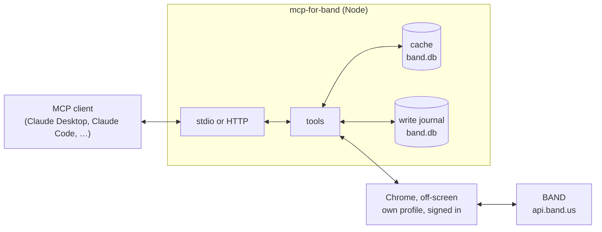

# How it works

mcp-for-band is one Node process that sits between an MCP client, such as Claude, and BAND. It drives its own copy of Chrome, signed in to BAND as you, and calls BAND's web API from inside BAND's own page. Reads come from a local SQLite cache. Writes wait in a journal until you approve them.

## The pieces

| Piece | Code | Job |
|---|---|---|
| Transports | `src/server.ts` | MCP over stdio (one client on this computer) or HTTP (bearer tokens). |
| Tools | `src/tools.ts`, `src/plugins/` | The MCP tools. Plugins add more, such as the F3 workout tools. |
| Chrome | `src/chrome.ts` | Starts and connects to the server's own Chrome. |
| BAND client | `src/band.ts` | Sends each API request through BAND's web client in that Chrome. |
| Sync and cache | `src/sync.ts`, `src/store.ts` | Copies BAND into SQLite and searches it. |
| Writes | `src/writes.ts`, `src/executors.ts`, `src/media.ts` | Drafts, approvals, the journal, and the requests that change BAND. |
| Settings | `src/config.ts` | Paths, ports, tokens and `settings.json`. |

## Chrome and sign-in

The server never sees your BAND password. It starts Google Chrome with its own profile in the data folder and a DevTools port on `127.0.0.1` (9333 by default), placed off-screen. It doesn't run headless, because headless Chrome says so in its user agent. If that Chrome is already running, the server connects to it instead of starting another, so several server processes can share it.

The first time, the `sign_in` tool (or `band-mcp signin`) moves the window on-screen at BAND's home page. You sign in like you would anywhere. When BAND shows a signed-in page, the window moves off-screen again. The profile keeps the session, so you sign in once.

BAND's session cookie lasts about 5 minutes and renews when a BAND page loads. Before calling BAND, the server reloads its tab if the last load was more than 4 minutes ago. If BAND sends the tab to a sign-in page, the call fails with an `auth` error that tells the model to use `sign_in`.

## Calling BAND

BAND's API rejects requests that its web app didn't sign. Instead of copying the signing, the server uses BAND's own code. On page load, a small script finds the API client class inside BAND's JavaScript bundle. Each call then runs that client's `send()` in the page, so BAND signs the request and refreshes the session itself. The request goes out from your browser with your cookies, the same way as a click in the web app.

Requests from one process run one at a time, at least 300 milliseconds apart. If BAND rate-limits (`result_code` 1003 or HTTP 429), the call stops with a `rate_limited` error rather than retrying. The endpoints, parameters and quirks are in [band-web-api.md](band-web-api.md).

## Reading: sync and the cache

Read tools never call BAND. They search the SQLite cache, `band.db` in the data folder, with full-text search across bands. That keeps answers fast and keeps traffic to BAND low.

- **`sync`** reads one band for a date range: the feed back to the start date, the calendar's events, the comments and replies on each, and, with `members: true`, the member list.
- **Coverage.** Each sync records which band, source and dates it covered, and whether it finished. Every read result says what the cache covers, so the model can tell you when it needs to sync first. Unknown stays unknown: a range that wasn't synced isn't reported as empty.
- **Edits and deletions.** A sync of an overlapping range updates changed items. Items BAND marks as deleted are marked in the cache too, and so is a comment that's missing when its post or event is read again. A post that just stops appearing in the feed stays in the cache, because the feed alone doesn't show that it was deleted.
- **Background sync** is off by default. With `syncIntervalMinutes` set in `settings.json`, `serve` re-syncs the `backgroundBands` for the last 14 days on that schedule. Most people don't need it: the model runs `sync` when a question needs fresh data. Background sync makes regular traffic to BAND whether anyone is asking or not.
- **Photos.** `get_media` downloads a cached item's photos into `media/` in the data folder, from BAND's image hosts only.

## Writing: draft, approve, send

Every change to BAND takes two steps, and only the user can do the second.

1. **Draft.** A `prepare_*` tool checks the request against the cache and BAND, and writes a draft to the journal (the `writes` table in `band.db`). It returns a plain-text preview: the band, the exact text, the target, each file with its full path and size, and what else happens, such as notifications. The draft stores a hash of the payload and each attached file's SHA-256. Drafts expire after 10 minutes.
2. **Approve.** The model shows you the preview and calls `confirm_write`. If the client supports MCP elicitation, the client asks you directly with an approval box. Otherwise you say yes in chat, and the model passes `user_approved: true`. A batch of up to 50 drafts takes one yes.
3. **Send.** The server runs approved writes one at a time. Just before each one, it checks:
   - the approval is under 10 minutes old;
   - the payload still matches its hash;
   - deletes are still allowed, for a delete;
   - for edits and post deletes, the post on BAND still has the text you saw;
   - each attached file still has the size and hash you approved. The server copies files into a private folder and checks the copies, so a file can't change mid-upload.

Each draft moves through these states: `pending` → `approved` → `executing` → `done` or `failed`. It can also end `rejected`, `expired`, or `unknown`. `unknown` means the request may have reached BAND but no answer came back. The server never retries those, because a retry could post twice. Every step is logged in `write_events`.

Photos and videos upload through BAND's own comment box in a separate tab, because BAND signs uploads in its own code too. That tab only uploads. The post or comment itself goes through the API with the uploaded file ids.

Deletes are off unless `allowDestructive` is `true` or `BAND_MCP_ALLOW_DESTRUCTIVE=1`. A deleted item's last cached copy stays in the journal.

## Transports

- **stdio** (`band-mcp stdio`) is for one client on this computer, such as Claude Code or Claude Desktop. It has every tool, and it asks for approvals through elicitation when the client supports it.
- **HTTP** (`band-mcp serve`) listens on `127.0.0.1:47811`, and also on this machine's Tailscale addresses with `BAND_MCP_TAILSCALE=1`. Never on other networks. Each request needs a bearer token from `secrets.json`. `readToken` sees only read tools; `writeToken` also sees `prepare_*` and `confirm_write`. The server rejects other hosts, cross-site browser requests, and batches over 20 requests. Approvals over HTTP happen with a yes in chat.

Both transports can run at once on the same data folder. They share Chrome, the cache and the journal.

## Plugins

A plugin is a folder in `src/plugins/` that adds tools and a line of instructions for the model. Turn plugins on with `plugins` in `settings.json`. The `f3` plugin reads backblasts from the cache and works out each workout's AO, Q, co-Qs, PAX count and attendees. See [plugins.md](plugins.md).

## The data folder

`%LOCALAPPDATA%\band-mcp` on Windows, `~/.local/share/band-mcp` elsewhere, or `BAND_MCP_DIR`.

| File | Holds |
|---|---|
| `profile/` | Chrome's profile, including your BAND session. |
| `band.db` | The cache, coverage, members and the write journal. |
| `media/` | Photos from `get_media`. |
| `secrets.json` | The HTTP tokens, created on first use. |
| `settings.json` | Your settings (see the README). |
| `endpoints.json` | Each BAND endpoint the server has called, with parameter names only. |

Everything stays on your computer. Treat the folder like a password: anyone with it can act as you on BAND.

## When BAND changes

BAND doesn't publish this API, so it can change without notice. The parts most likely to break:

- **Finding BAND's client.** The server finds it by shape, not by name. If the bundle changes shape, every call fails with "Couldn't find BAND's API client in the page".
- **Response shapes.** The extractors in `src/sync.ts` look for fields such as `post_no` and `comment_id` anywhere in a response, so small moves don't break them. A renamed field drops items until the extractor is updated.
- **Write parameters.** A changed write fails with BAND's `result_code` 200 (bad parameters). It fails as a definite error and is never sent twice.

To map or fix an endpoint, see "Mapping an endpoint" in [band-web-api.md](band-web-api.md).
